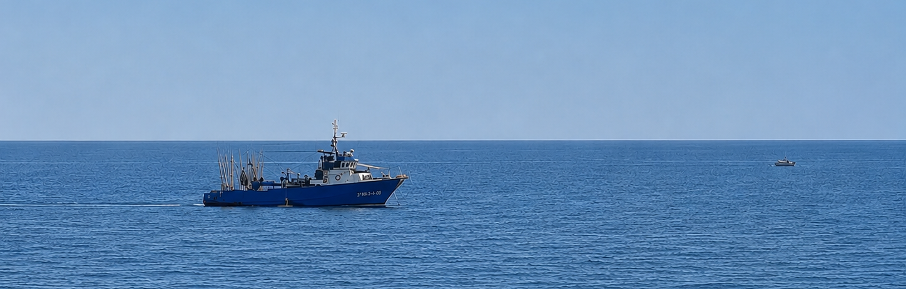
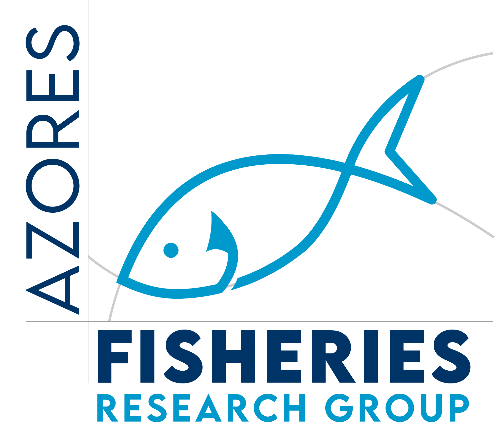

```{=html}
<div class="home-hero">
  
  <div class="home-hero-content">
    <p>Investigação das pescas nos Açores</p>
    <h1>Conhecer o mar, compreender as pescas</h1>
    <p>Explore as espécies, os dados e o trabalho da nossa equipa.</p>
  </div>
</div>
```

## Explore o portal

```{=html}
<nav class="home-links" aria-label="Explorar o portal">
  <a class="home-link" href="map.html">
    <span class="home-link-title">Explorador de Mapas</span>
    <span>Explore a informação geográfica sobre as pescas.</span>
    <span class="home-link-action">Explorar →</span>
  </a>
  <a class="home-link" href="species/index.html">
    <span class="home-link-title">Espécies</span>
    <span>Conheça as espécies estudadas e a sua biologia.</span>
    <span class="home-link-action">Explorar →</span>
  </a>
  <a class="home-link" href="fisheries.html">
    <span class="home-link-title">Dados das Pescas</span>
    <span>Consulte dados e gráficos sobre as pescas.</span>
    <span class="home-link-action">Explorar →</span>
  </a>
  <a class="home-link" href="publications.html">
    <span class="home-link-title">Publicações</span>
    <span>Encontre artigos e relatórios publicados.</span>
    <span class="home-link-action">Explorar →</span>
  </a>
  <a class="home-link" href="projects.html">
    <span class="home-link-title">Projectos</span>
    <span>Descubra os projectos da equipa.</span>
    <span class="home-link-action">Explorar →</span>
  </a>
</nav>
```

## Sobre a equipa {#sobre}

```{=html}
<div class="team-intro">
  
  <div>
    <h3>Azores Fisheries Research Group — AzFRG</h3>
    <p class="team-intro-translation">Grupo de Investigação das Pescas dos Açores</p>
    <p>Universidade dos Açores · Instituto OKEANOS</p>
    <p>Morada: <em>a preencher</em></p>
    <p>O AzFRG é uma equipa de investigação baseada na Universidade dos Açores, que trabalha em colaboração com o Instituto OKEANOS. Liderada pelo Prof. Doutor Régis Santos, a equipa reúne investigadores, estudantes e técnicos dedicados ao estudo das pescas e da biologia dos recursos marinhos da região.</p>
    <p>O seu trabalho aborda a biologia das espécies, os impactos da pesca e o estado dos recursos marinhos explorados nos Açores.</p>
  </div>
</div>
```

### Membros


#### Coordenação

```{=html}
<div class="member-row">
  <div class="member">
    
    <h5>Prof. Doutor Régis Santos</h5>
    <p class="role">Líder da equipa</p>
    <p>Breve descrição (áreas de investigação, contacto).</p>
  </div>
</div>
```

#### Doutorados

```{=html}
<div class="member-row">
  <div class="member">
    
    <h5>(Nome)</h5>
    <p class="role">Investigador(a) doutorado(a)</p>
    <p>Breve descrição. <em>(Por escrever.)</em></p>
  </div>
  <div class="member">
    
    <h5>(Nome)</h5>
    <p class="role">Investigador(a) doutorado(a)</p>
    <p>Breve descrição. <em>(Por escrever.)</em></p>
  </div>
  <div class="member">
    
    <h5>(Nome)</h5>
    <p class="role">Investigador(a) doutorado(a)</p>
    <p>Breve descrição. <em>(Por escrever.)</em></p>
  </div>
</div>
```

#### Técnicos e estudantes

```{=html}
<div class="member-row">
  <div class="member">
    
    <h5>(Nome)</h5>
    <p class="role">Técnico(a)</p>
    <p>Breve descrição. <em>(Por escrever.)</em></p>
  </div>
  <div class="member">
    
    <h5>(Nome)</h5>
    <p class="role">Estudante de doutoramento</p>
    <p>Breve descrição. <em>(Por escrever.)</em></p>
  </div>
  <div class="member">
    
    <h5>(Nome)</h5>
    <p class="role">Estudante de mestrado</p>
    <p>Breve descrição. <em>(Por escrever.)</em></p>
  </div>
</div>
```

#### Colaboradores

```{=html}
<div class="member-row">
  <div class="member">
    
    <h5>(Nome)</h5>
    <p class="role">Colaborador(a) — (Instituição)</p>
    <p>Breve descrição. <em>(Por escrever.)</em></p>
  </div>
  <div class="member">
    
    <h5>(Nome)</h5>
    <p class="role">Colaborador(a) — (Instituição)</p>
    <p>Breve descrição. <em>(Por escrever.)</em></p>
  </div>
</div>
```

### Notícias

- *(Data)* — Título da notícia. *(Por escrever.)*

```{=html}
<div class="inicio-mar" aria-hidden="true">
  
</div>
<script>
(() => {
  const navbar = document.querySelector("#quarto-header .navbar");
  if (!navbar) return;

  const image = new URL("images/OC_edited.png", document.baseURI).href;
  navbar.style.setProperty("--home-header-image", `url("${image}")`);
  const updateHeader = () => navbar.classList.toggle("home-navbar-top", window.scrollY < 40);
  updateHeader();
  window.addEventListener("scroll", updateHeader, { passive: true });
})();
</script>
```
