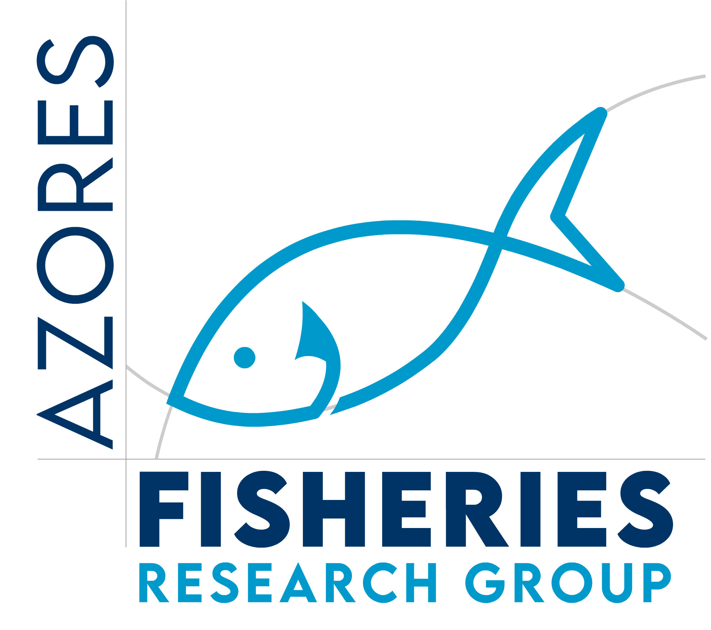

{width=120 fig-align="right"}

::: {.grid}
::: {.g-col-4 .stat-box}
<span class="num">2</span><br>espécies descritas
:::
::: {.g-col-4 .stat-box}
<span class="num">12</span><br>anos de dados de desembarques
:::
::: {.g-col-4 .stat-box}
<span class="num">3</span><br>publicações
:::
:::

## Resultado em destaque

```{r}
library(plotly)
d <- read.csv("data/landings.csv")
plot_ly(d, x = ~year, y = ~tonnes, color = ~species, type = "scatter",
        mode = "lines+markers") |>
  layout(xaxis = list(title = "Ano"), yaxis = list(title = "Desembarques (toneladas)"))
```

::: {.plain-words}
**Em palavras simples:** este gráfico mostra a quantidade de cada espécie desembarcada por ano. *(Texto e dados provisórios.)*
:::

## Sobre a equipa {#sobre}

A equipa de investigação das pescas nos Açores é um grupo baseado na Universidade dos Açores, que trabalha em colaboração com o Instituto OKEANOS...
Liderada pelo Prof. Doutor Régis Santos, a equipa inclui investigadores, estudantes e técnicos que se dedicam ao estudo das pescas e da biologia marinha voltada para os recursos pesqueiros na região.

### Objetivos
O objetivo é estudar as pescas nos Açores, incluindo a biologia das espécies, os impactos da pesca e o estado dos estoques dos principais recursos marinhos explorados na região.

### Notícias

- *(Data)* — Título da notícia. *(Por escrever.)*

### Membros

| Nome | Função | Contacto |
|------|--------|----------|
| *(Nome)* | *(Função)* | *(email)* |
